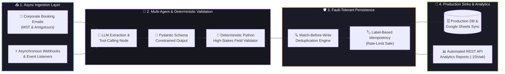
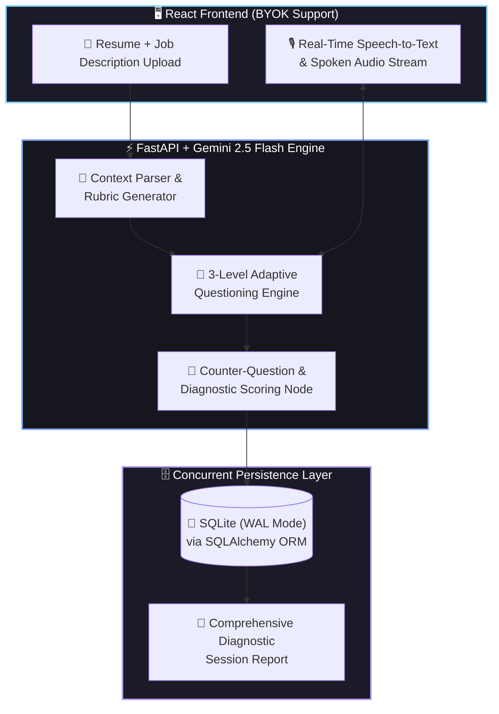
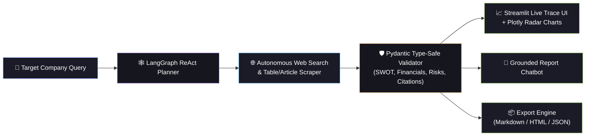

```markdown
<div align="center">

  <!-- ANIMATED HERO BANNER -->
  

  <!-- ANIMATED TYPING SVG -->
  <a href="https://github.com/adarsh-dubey-gthb">
    
  </a>

  <br/><br/>

  <!-- CONTACT & LIVE PORTFOLIO BADGES -->
  <a href="https://axiomtech.live" target="_blank">
    
  </a>
  <a href="https://www.linkedin.com/in/adarsh-dubey-a9b5bb322/" target="_blank">
    
  </a>
  <a href="mailto:contact.adarshdubey@gmail.com">
    
  </a>
  
  

</div>

<br/>

---

### ⚡ `whoami` — System Telemetry & Engineering Summary

```yaml
adarsh@ai-engine:~$ cat profile_manifest.yaml
──────────────────────────────────────────────────────────────────────────────────────────
👤 Engineer       : Adarsh Dubey (Delhi NCR, India)
🎯 Core Mission   : AI Engineer who designs, builds & deploys LLM apps, ML models & full-stack AI products
🎓 Education      : B.Tech in CSE @ ABES Engineering College, Ghaziabad (2024–2028) | SGPA: 8.0/10
💼 Current Role   : Founder & AI Engineer (Jan 2025 – Present) | Production B2B Multi-Agent Systems
🧠 Specializations: Multi-Agent Orchestration (LangGraph/CrewAI), Voice/Speech Pipelines, Predictive ML
🛡️ Engineering Law: Deterministic Python & Pydantic Schema Validation > Raw Unchecked LLM Reasoning
📈 Impact Metrics : 2,000+ Monthly Bookings Automated | 80% Faster Response | 500+ Dev Users on Axiom
⚔️ Algorithmic CP : Codeforces (Max 1455) | CodeChef (Max 1416) | LeetCode (126+ Solved) | Kaggle Top 5%

```

---

### 🏗️ Production AI & System Architectures

*Click the interactive toggles below to inspect the live engineering architectures behind my production deployments.*

> **Production Impact (Jan 2025 – Present):** Automated **2,000+ monthly bookings**, reduced manual response latency by **80%**, and saved **~15 admin hours/week** across two corporate transport companies (MST and Amigotours). Engineered with deterministic Python cross-checks and label-based idempotency to prevent duplicate writes during API rate-limit failures.



> **Architecture Overview:** Full-stack real-time voice interviewer powered by **FastAPI, React, Gemini 2.5 Flash, and SQLite (WAL mode)**. Converts raw job descriptions and candidate resumes into a 3-level adaptive technical interview with live counter-questioning and diagnostic scoring.



> **Architecture Overview:** Autonomous **LangGraph + Gemini 2.5 Flash** ReAct research agent that dynamically plans web searches, scrapes articles/tables, enforces strict **Pydantic** validation, and renders live traces and **Plotly** radar charts inside **Streamlit**.



---

### 🛠️ Categorized Technical Arsenal

| Domain | Technologies, Frameworks & Libraries |
| --- | --- |
| **Languages** |       |
| **AI, Agents & ML** |          |
| **Backend & Data** |          |
| **Frontend, Voice & Cloud** |       |
| **Vector DBs & DevOps** |       |

---

### 🚀 Featured Engineering Projects (6 Production & ML Builds)

---

### 🏆 Hackathons, Competitive Programming & Academic Pedigree

* 🏆 **Best Performing Team (Idea Pitching) — IDE Bootcamp Phase 2 (Apr 2026):** Awarded by the **Ministry of Education, AICTE, and Wadhwani Foundation**.
* 🇮🇳 **National Hackathon Finalist & Builder:**
* **Smart India Hackathon (SIH)**
* **AI4Bharat Hackathon**
* **Agentic AI Hackathon** (GL Bajaj)
* **Makeathon 8** (TIET Patiala)


* 🧠 **TATA Crucible Campus Quiz (2025):** National corporate & technology quiz competitor.

| Platform | Peak Rating / Milestone | Core Focus |
| --- | --- | --- |
|  | **Max Rating: 1455** | Algorithmic Problem Solving, Graphs, Greedy, DP (`C++`) |
|  | **Max Rating: 1416** | Timed Rated Contests & Number Theory (`C++`) |
|  | **126+ Solved** | Data Structures, Trees, Sliding Window, System Design |
|  | **Top 5% Rank** | Tabular ML, Feature Engineering & Hyperparameter Tuning |

* **Institution:** ABES Engineering College, Ghaziabad — *B.Tech in Computer Science and Engineering (Aug 2024 – May 2028)*
* **Academic Standing:** **SGPA: 8.0 / 10.0**
* **Core CS Coursework:** Data Structures & Algorithms (DSA), Object-Oriented Programming (OOP), Database Management Systems (DBMS), Operating Systems (OS), Computer Networks (CN), Machine Learning (ML).

---

### 📊 Live GitHub Telemetry & Contribution Velocity


---

### 🤝 Open to AI/ML Engineering Roles & High-Impact Collaborations

*Designing deterministic, production-grade multi-agent systems and full-stack AI applications.*

Would you like me to plug in the exact GitHub repository URLs for **Interview Accelerator**, **Market Intelligence Agent**, **Scholarship Intelligence Crawler**, **Project Yatra**, and **Employee Burnout Prediction** so the project cards have clickable `[Live Demo]` and `[GitHub Repo]` buttons?
