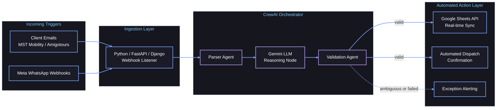
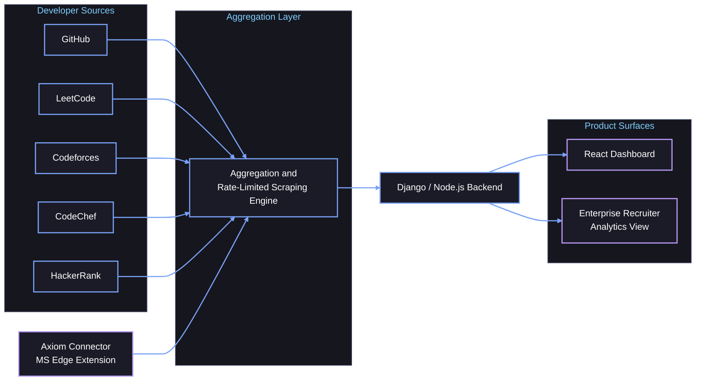

<div align="center">


<br>

<a href="https://axiomtech.live"></a>
<a href="https://www.linkedin.com/in/adarsh-dubey-a9b5bb322/"></a>
<a href="mailto:adarsh@axiomtech.live"></a>
<!-- Replace the URL below with your Instagram profile link -->
<a href="https://www.instagram.com/"></a>

<sub>Also reachable at <a href="mailto:contact.adarshdubey@gmail.com">contact.adarshdubey@gmail.com</a> · <a href="https://www.linkedin.com/in/adarshdubeydl/">alternate LinkedIn profile</a></sub>

</div>

<br>

### About Me

```yaml
# adarsh_os.sh : system fetch
user: adarsh@axiom
os: "Night Owl Developer"
host: "ABES Engineering College, Ghaziabad"
education: "B.Tech, Computer Science & Engineering (Class of 2028)"
status: "Building Axiom, running CrewBot AI"
roles:
  - "Founder & Lead Developer @ Axiom (axiomtech.live)"
  - "Founder & Lead AI Architect @ CrewBot AI"
  - "Previously: AI Agent Development Intern @ Gravity AI"
architecture_focus:
  - "Multi-agent workflows (CrewAI, Gemini)"
  - "Webhook-driven automation and Google Sheets pipelines"
  - "B2B SaaS: Django / Node.js backends, React dashboards, browser extensions"
agency_work: "Corporate transport automation for MST Mobility and Amigotours"
competitive_shell: "C++ (STL)"
off_screen:
  - "Evening gym"
  - "Cinematic developer storytelling on Instagram"
uptime: "Late nights"
```

### System Architecture

<details open>
<summary><b>CrewBot AI: Multi-Agent Production Pipeline</b></summary>
<br>



</details>

<details>
<summary><b>Axiom (axiomtech.live): Ecosystem Architecture</b></summary>
<br>



</details>

### Tech Arsenal

<div align="center">

<table>
  <tr>
    <td align="center"><b>Languages</b></td>
    <td align="left">
      
      
      
      
      
    </td>
  </tr>
  <tr>
    <td align="center"><b>AI &amp; Agentic Workflows</b></td>
    <td align="left">
      
      
      
      
      
      
    </td>
  </tr>
  <tr>
    <td align="center"><b>Backend &amp; Cloud</b></td>
    <td align="left">
      
      
      
      
      
      
      
      
      
    </td>
  </tr>
  <tr>
    <td align="center"><b>Frontend &amp; Extensions</b></td>
    <td align="left">
      
      
      
      
      
    </td>
  </tr>
</table>

</div>

### Featured Production Showcase

<div align="center">

<table>
  <tr>
    <td width="50%" valign="top" align="left">
      <b>Axiom</b> · <a href="https://axiomtech.live">axiomtech.live</a><br>
      <sub>B2B SaaS talent platform + Axiom Connector (MS Edge extension)</sub><br><br>
      Aggregates developer credentials and real-time portfolio metrics across GitHub, LeetCode, Codeforces, CodeChef, and HackerRank. Deployed on Render with a custom domain; the Axiom Connector extension is published on the Microsoft Edge Add-ons store.<br><br>
      <b>60+</b> concurrent users in live beta<br>
      <b>1st place</b>, IDE Bootcamp Edition 3 pitching competition<br><br>
      <sub><code>Django</code> · <code>Node.js</code> · <code>React</code> · <code>Edge Extension</code> · <code>Render</code></sub>
    </td>
    <td width="50%" valign="top" align="left">
      <b>CrewBot AI Automation Suite</b><br>
      <sub>Multi-agent booking and email-to-Sheets extraction</sub><br><br>
      Production multi-agent system for corporate transport clients (MST Mobility and Amigotours): booking management, Meta Webhook integrations, and automated extraction of email data into Google Sheets.<br><br>
      <a href="#system-architecture">See the pipeline diagram</a><br><br>
      <sub><code>Python</code> · <code>CrewAI</code> · <code>Gemini</code> · <code>Google Sheets API</code> · <code>Webhooks</code></sub>
    </td>
  </tr>
  <tr>
    <td width="50%" valign="top" align="left">
      <b>NewsTTS</b><br>
      <sub>Real-time AI audio dubbing web application</sub><br><br>
      Dubs news content into audio using speech recognition and Indic text-to-speech models behind a Django web interface.<br><br>
      <sub><code>Django</code> · <code>Faster-Whisper</code> · <code>Indic TTS</code></sub><br><br>
      <a href="https://github.com/adarsh-dubey-gthb?tab=repositories">Browse my repositories</a>
    </td>
    <td width="50%" valign="top" align="left">
      <b>IntelliTransit, AI Interviewer &amp; Scholarship Scraper</b><br>
      <sub>Data, AI, and automation projects</sub><br><br>
      Published a GTFS public transportation dataset on Kaggle (Smart India Hackathon project), alongside an interactive Gemini-powered AI Interviewer platform and an automated scholarship scraper.<br><br>
      <sub><code>Python</code> · <code>Gemini API</code> · <code>GTFS</code> · <code>Web scraping</code></sub><br><br>
      <a href="https://github.com/adarsh-dubey-gthb?tab=repositories">Browse my repositories</a>
    </td>
  </tr>
</table>

</div>

### Milestones

<details>
<summary><b>🏆 Hackathons, Wins &amp; Recognition</b></summary>
<br>

- **Winner (1st Place):** Pitching Competition at Innovation, Design & Entrepreneurship (IDE) Bootcamp Edition 3, SGT University, for Axiom.
- **Competitor & Builder:** Smart India Hackathon (IntelliTransit) and AI for Bharat Hackathon.

</details>

<details>
<summary><b>⚔️ Competitive Programming &amp; Problem Solving</b></summary>
<br>

Primary language: **C++ (STL)**

<!-- Swap each "coming soon" badge for a live rating badge once you pick a rating source -->
| Platform | Profile | Language | Live rating |
| :--- | :--- | :--- | :--- |
| LeetCode | [adarshdubey_007](https://leetcode.com/u/adarshdubey_007/) | `C++ STL` |  |
| Codeforces | [adarshdubey_007](https://codeforces.com/profile/adarshdubey_007) | `C++ STL` |  |
| CodeChef | [contact_adarsh](https://www.codechef.com/users/contact_adarsh) | `C++ STL` |  |
| HackerRank | add handle | `C++ STL` |  |

</details>

<details>
<summary><b>🎬 Beyond the Terminal (Content &amp; Lifestyle)</b></summary>
<br>

- **Instagram creator journey:** cinematic developer storytelling, with voiceovers, aesthetic coding routines, and project-building reels.
- **Evening gym discipline:** a fixed evening session that balances late-night coding.
- **Night owl by default:** most shipping happens after dark.

</details>

### Live GitHub Analytics

<div align="center">

<table>
  <tr>
    <td align="center" valign="top">
      
    </td>
    <td align="center" valign="top">
      
    </td>
  </tr>
</table>


<br><br>


</div>

<div align="center">


</div>
