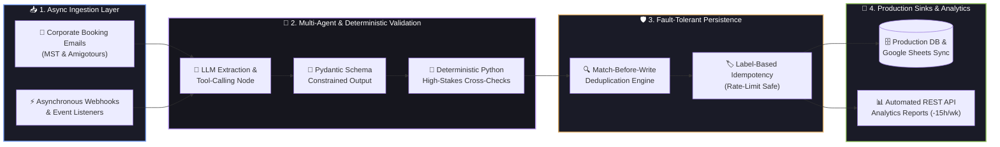
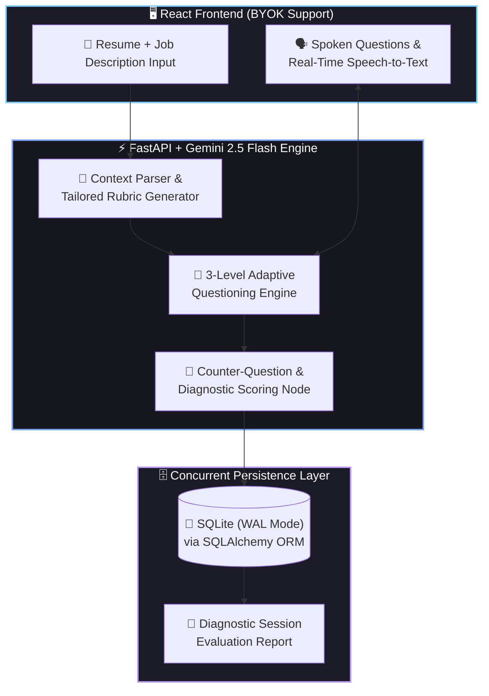
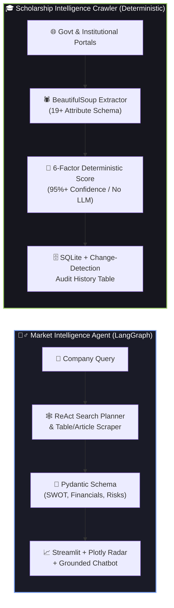

<div align="center">
  <!-- ANIMATED HERO BANNER -->

  <!-- ANIMATED TYPING SVG -->
<a href="https://github.com/adarsh-dubey-gthb">
    
  </a>
<br/><br/>
  <!-- CONTACT & LIVE PORTFOLIO BADGES -->
<a href="https://axiomtech.live" target="_blank">
    
  </a>
  <a href="https://www.linkedin.com/in/adarsh-dubey-a9b5bb322/" target="_blank">
    
  </a>
  <a href="mailto:contact.adarshdubey@gmail.com">
    
  </a>
  <a href="tel:+919473629700">
    
  </a>
  
  
</div>
<br/>
---
⚡ `whoami` — System Telemetry & Engineering Summary
```yaml
adarsh@ai-engine:~$ cat profile_manifest.yaml
──────────────────────────────────────────────────────────────────────────────────────────
👤 Engineer       : Adarsh Dubey | +91 9473629700 | contact.adarshdubey@gmail.com | Delhi NCR, India
🎯 Core Mission   : AI Engineer who designs, builds & deploys LLM apps, ML models & full-stack AI products
🎓 Education      : B.Tech in CSE @ ABES Engineering College, Ghaziabad (Aug 2024 – May 2028) | SGPA: 8.0/10
💼 Current Role   : Founder & AI Engineer (Jan 2025 – Present) | Production B2B Multi-Agent Automation
🧠 Specializations: Multi-Agent Systems (LangGraph/CrewAI), Speech/Translation Pipelines, Predictive ML
🛡️ Engineering Law: Deterministic Python & Pydantic Schema Validation > Raw Unchecked LLM Reasoning
📈 Impact Metrics : 2,000+ Monthly Bookings Automated | -80% Response Time | -15 Admin Hrs/Wk | 500+ Dev Users
⚔️ Algorithmic CP : Codeforces (Max 1455) | CodeChef (Max 1416) | LeetCode (126+ Solved) | Kaggle Top 5%
```
---
💼 Production Work Experience
<table width="100%">
  <tr>
    <td width="100%" valign="top">
      <h3>🚀 Founder & AI Engineer — Freelance / Self-Employed <code>(Jan 2025 – Present)</code></h3>
      <p>
        
        
        
        
      </p>
      <ul>
        <li><b>Multi-Agent Fleet & Booking Automation:</b> Designed and deployed end-to-end multi-agent booking automation for two corporate transport companies (<b>MST</b> and <b>Amigotours</b>), covering automated email ingestion, LLM extraction, and live database/Google Sheets updates.</li>
        <li><b>High-Throughput Async Execution:</b> Automated <b>2,000+ monthly bookings</b> and cut manual customer response time by <b>80%</b> using asynchronous webhooks and structured LLM tool-calling.</li>
        <li><b>Deterministic Guardrails:</b> Favoured deterministic Python validation over raw LLM reasoning, enforcing strict schema-constrained outputs (Pydantic) and automated cross-checks on high-stakes booking fields.</li>
        <li><b>Production Reliability & Idempotency:</b> Diagnosed and resolved a critical production bug where API rate-limit failures caused silent duplicate writes, implementing <b>match-before-write logic</b> and <b>label-based idempotency</b>.</li>
        <li><b>Automated Executive Reporting:</b> Built automated REST API analytics and dispatch reporting pipelines, saving approximately <b>15 administrative hours per week</b>.</li>
      </ul>
    </td>
  </tr>
</table>
---
🏗️ Interactive System & Agentic Architectures
Click the interactive toggles below to inspect the live production workflows and agent graphs powering my deployments.
<details open>
<summary><b>🤖 1. B2B Multi-Agent Booking Automation Pipeline — MST & Amigotours (Click to Collapse)</b></summary>
<br/>

</details>
<details>
<summary><b>🎙️ 2. Interview Accelerator — 3-Level Adaptive Voice AI Simulator (Click to Expand)</b></summary>
<br/>

</details>
<details>
<summary><b>📊 3. Market Intelligence ReAct Agent & Deterministic Scholarship Crawler (Click to Expand)</b></summary>
<br/>

</details>
---
🛠️ Categorized Technical Arsenal
<div align="center">
Domain	Technologies, Frameworks & Libraries
Languages	     
AI, Agents & ML	        
Backend & Data	       -003B57?style=for-the-badge&logo=sqlite&logoColor=white)  
Frontend & Cloud	   -232F3E?style=for-the-badge&logo=amazonaws&logoColor=FF9900)  
Tools & Vector DBs	      
</div>
---
🚀 Featured Engineering Projects (Full-Stack AI, Agents & Predictive ML)
<table width="100%">
  <tr>
    <td width="50%" valign="top">
      <h3 align="center">🎙️ Interview Accelerator — AI Mock Interview Simulator</h3>
      <p align="center">
        <a href="https://github.com/adarsh-dubey-gthb?tab=repositories&q=Interview" target="_blank">
          
        </a>
        <a href="https://github.com/adarsh-dubey-gthb?tab=repositories&q=Interview" target="_blank">
          
        </a>
      </p>
      <p><b><code>2026</code> | <code>FastAPI</code> • <code>React</code> • <code>Gemini 2.5 Flash</code> • <code>SQLite (WAL)</code> • <code>SQLAlchemy</code></b></p>
      <ul>
        <li>Built and deployed a full-stack voice interviewer that turns a job description and resume into a tailored technical interview, featuring spoken questions and real-time speech-to-text answers.</li>
        <li>Implemented a <b>3-level adaptive questioning engine</b> with dynamic counter-questions and diagnostic scoring.</li>
        <li>Persisted sessions and analytical reports in <b>SQLite (WAL mode)</b> via SQLAlchemy, complete with a <b>Bring-Your-Own-Key (BYOK)</b> option for the live application.</li>
      </ul>
    </td>
    <td width="50%" valign="top">
      <h3 align="center">🕵️‍♂️ Market Intelligence Agent — ReAct Benchmark Suite</h3>
      <p align="center">
        <a href="https://github.com/adarsh-dubey-gthb?tab=repositories&q=Market" target="_blank">
          
        </a>
        
      </p>
      <p><b><code>2026</code> | <code>LangGraph</code> • <code>LangChain</code> • <code>Gemini 2.5 Flash</code> • <code>Pydantic</code> • <code>Streamlit</code> • <code>Plotly</code></b></p>
      <ul>
        <li>Built an autonomous <b>ReAct research agent</b> that plans its own web searches, scrapes articles and financial tables, and benchmarks a target company against its competitors.</li>
        <li>Enforced a strict <b>Pydantic report schema</b> (SWOT, financial metrics, risks, cited sources) so every output is valid and type-safe, supporting <b>Markdown, HTML, and JSON export</b>.</li>
        <li>Shipped an interactive <b>Streamlit</b> dashboard with live agent reasoning traces, <b>Plotly radar charts</b>, and a conversational chatbot grounded in the generated report.</li>
      </ul>
    </td>
  </tr>
  <tr>
    <td width="50%" valign="top">
      <h3 align="center">🎓 Scholarship Intelligence Crawler</h3>
      <p align="center">
        <a href="https://github.com/adarsh-dubey-gthb?tab=repositories&q=Scholarship" target="_blank">
          
        </a>
        
      </p>
      <p><b><code>2026</code> | <code>Python</code> • <code>BeautifulSoup</code> • <code>SQLite</code> • <code>Streamlit</code></b></p>
      <ul>
        <li>Built an end-to-end <b>crawl, extract, verify, score, and store</b> pipeline collecting 24 real Indian scholarships into a <b>19+ attribute schema</b>, with <b>23 verified</b> against official government and institutional portals.</li>
        <li>Designed a <b>deterministic 6-factor confidence score (no LLM)</b> achieving <b>95%+ confidence on 23 records</b>, paired with a semantic validator that rejects non-scholarship government pages.</li>
        <li>Added automated change detection with a history audit table that logged a real deadline extension and benefit revision in production.</li>
      </ul>
    </td>
    <td width="50%" valign="top">
      <h3 align="center">🌐 Axiomtech.live — Developer Networking Platform</h3>
      <p align="center">
        <a href="https://axiomtech.live" target="_blank">
          
        </a>
        
      </p>
      <p><b><code>Jan – Mar 2026</code> | <code>Django</code> • <code>React</code> • <code>PostgreSQL</code> • <code>REST APIs</code> • <code>JWT</code></b></p>
      <ul>
        <li>Architected and deployed a full-stack networking platform serving <b>500+ developers</b> with secure JWT authentication, interactive project showcases, and team collaboration tools.</li>
        <li>Optimised complex <b>PostgreSQL queries</b> and REST API serialization endpoints, cutting initial page load time by <b>35%</b>.</li>
      </ul>
    </td>
  </tr>
  <tr>
    <td width="50%" valign="top">
      <h3 align="center">🚍 Project Yatra — Delhi Bus Tracking & ML ETA</h3>
      <p align="center">
        <a href="https://github.com/adarsh-dubey-gthb?tab=repositories&q=Yatra" target="_blank">
          
        </a>
        
      </p>
      <p><b><code>Oct 2025 – Feb 2026</code> | <code>Python</code> • <code>Flask</code> • <code>GTFS-Realtime</code> • <code>Scikit-Learn</code></b></p>
      <ul>
        <li>Built a real-time Delhi public bus tracking platform that continuously ingests and parses live <b>GTFS-Realtime</b> protobuf feeds.</li>
        <li>Trained and integrated a custom <b>Scikit-Learn machine learning model</b> to dynamically predict accurate bus arrival times (ETAs) across live routes.</li>
      </ul>
    </td>
    <td width="50%" valign="top">
      <h3 align="center">📈 Employee Burnout Prediction — Top 5% Kaggle</h3>
      <p align="center">
        <a href="https://github.com/adarsh-dubey-gthb?tab=repositories&q=Burnout" target="_blank">
          
        </a>
        
      </p>
      <p><b><code>Feb 2026</code> | <code>Python</code> • <code>Scikit-Learn</code> • <code>Pandas</code> • <code>Feature Engineering</code></b></p>
      <ul>
        <li>Ranked in the <b>Top 5%</b> globally on a competitive Kaggle employee burnout-score challenge.</li>
        <li>Executed domain-specific feature engineering and systematic hyperparameter tuning across <b>10,000+ records</b> to achieve an $R^2$ score of <b>0.88</b>.</li>
      </ul>
    </td>
  </tr>
</table>
---
🏆 Hackathons, Competitive Programming & Academic Foundation
<details open>
<summary><b>🥇 Hackathon Recognitions & National Competitions (Click to Collapse)</b></summary>
<br/>
🏆 Best Performing Team (Idea Pitching) — IDE Bootcamp Phase 2 (Apr 2026): Conferred by the Ministry of Education, AICTE, and Wadhwani Foundation.
🚀 National & Premier Hackathons:
Smart India Hackathon (SIH)
AI4Bharat Hackathon
Agentic AI Hackathon (GL Bajaj)
Makeathon 8 (TIET Patiala)
🧠 TATA Crucible Campus Quiz (2025): National business & technology quiz competitor.
</details>
<details open>
<summary><b>⚔️ Competitive Programming & Machine Learning Benchmarks (Click to Collapse)</b></summary>
<br/>
<div align="center">
Platform	Verified Milestone / Peak Rating	Core Domain Focus
-1F8ACB?style=for-the-badge&logo=codeforces&logoColor=white)	Max Rating: 1455	Graphs, Dynamic Programming, Greedy, Constructive Algorithms (`C++`)
	Max Rating: 1416	Rated Competitive Contests, Number Theory & Combinatorics (`C++`)
	126+ Solved	Data Structures & Algorithms, Trees, Sliding Window, Recursion
-20BEFF?style=for-the-badge&logo=kaggle&logoColor=white)	Top 5% Leaderboard	Feature Engineering, Ensemble Modeling & Hyperparameter Tuning
</div>
</details>
<details open>
<summary><b>🎓 Education & Core Computer Science Coursework (Click to Collapse)</b></summary>
<br/>
Institution: ABES Engineering College, Ghaziabad
Degree: B.Tech in Computer Science and Engineering (Aug 2024 – May 2028)
Academic Performance: SGPA: 8.0 / 10.0
Core Coursework: Data Structures & Algorithms, Object-Oriented Programming (OOP), Database Management Systems (DBMS), Operating Systems, Computer Networks, Machine Learning.
</details>
---
📊 Live GitHub Telemetry & Contribution Velocity
<div align="center">
  <!-- GITHUB STATS & TOP LANGUAGES -->

  
<br/><br/>
  <!-- GITHUB STREAK STATS -->

<br/><br/>
  <!-- FULL-WIDTH CONTRIBUTION GRAPH -->

</div>
---
<div align="center">
🤝 Seeking AI / ML Engineering Opportunities & High-Impact Builds
From deterministic multi-agent workflows and real-time voice pipelines to scalable full-stack AI platforms.
<a href="https://axiomtech.live" target="_blank"></a>
<a href="https://www.linkedin.com/in/adarsh-dubey-a9b5bb322/" target="_blank"></a>
<a href="mailto:contact.adarshdubey@gmail.com"></a>
<a href="tel:+919473629700"></a>
  <!-- ANIMATED FOOTER WAVE -->

</div>
